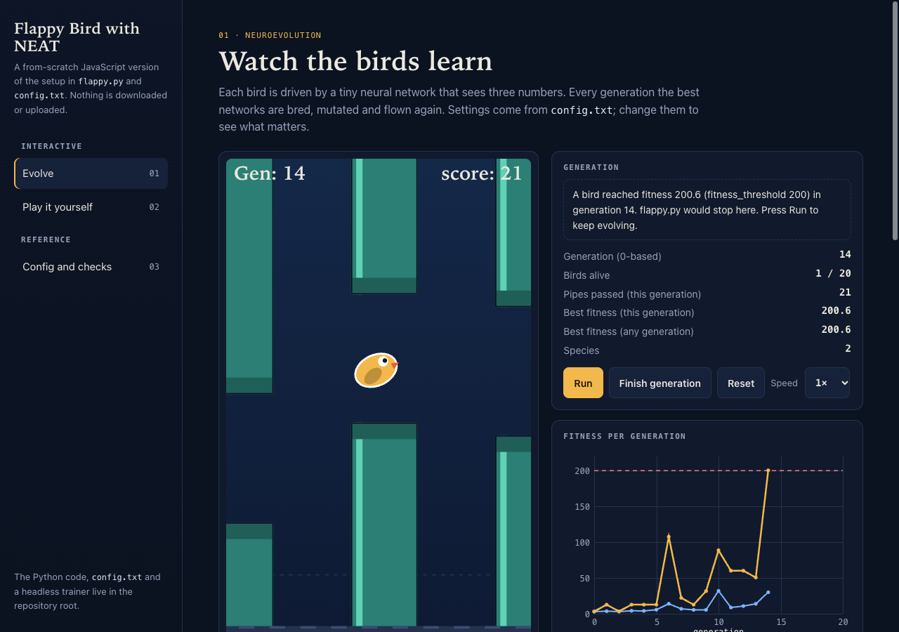
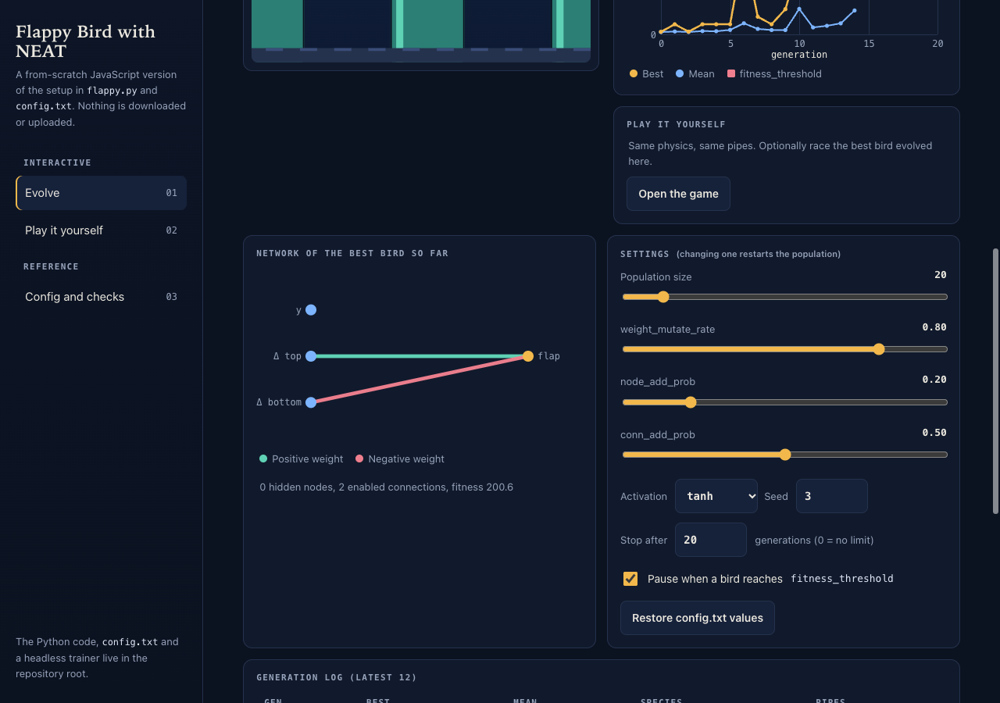
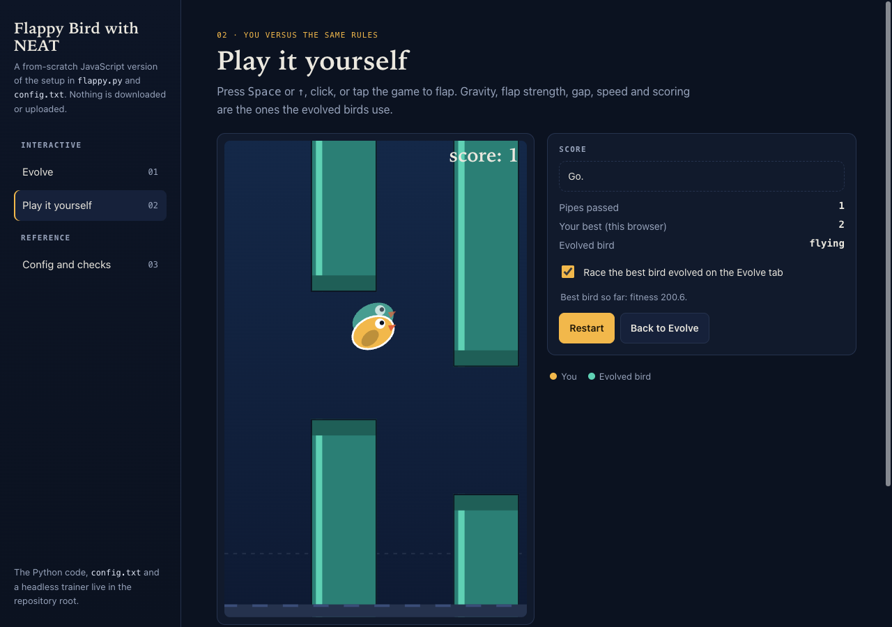

# Flappy Bird AI with NEAT

A Pygame version of Flappy Bird whose players are neural networks evolved with NEAT (NeuroEvolution of Augmenting Topologies, via the `neat-python` library). Each generation of 20 birds flies the same course; the best networks are bred and mutated; the next generation flies. The AI learns to steer the bird past the pipes by repeating this over generations.

This repository also contains an in-browser demo that re-implements the same game rules and the same NEAT configuration from scratch in JavaScript, with a live fitness chart and a mode where you play yourself.


*The original game while training (generation 2, score 1).*

## Try it in the browser

Open [`docs/index.html`](docs/index.html) in any modern browser (double-click it, or run `python -m http.server -d docs` and open `localhost:8000`). It is a single file with no external requests. GitHub Pages is not enabled for this repository, so there is no hosted link.



| Tab | What it does |
|---|---|
| Evolve | Runs the NEAT loop live. All birds of a generation fly at once; a chart shows best and mean fitness per generation; a diagram shows the best network found so far. Sliders change population size, `weight_mutate_rate`, `node_add_prob`, `conn_add_prob`, activation function and seed; the run restarts when you change one. |
| Play it yourself | Same physics and pipes. Flap with Space, the up arrow, a click or a tap. Optionally race the best bird evolved on the Evolve tab. |
| Config and checks | The parsed `config.txt`, the game rules copied from `flappy.py`, and the measured comparison with the Python code (below). |





## How to run the Python code

1. Clone the repository:

```
git clone https://github.com/AaronMackenzie/Flappy-Bird-AI-with-NEAT.git
cd Flappy-Bird-AI-with-NEAT
```

2. Install dependencies:

```
pip install -r requirements.txt
```

3. Run it:

```
python make_placeholder_imgs.py     # only if you do not have the original sprites (see Honest notes)
python flappy.py                    # the pygame window, 20 generations
python headless_train.py            # same task, no window, no sprites
```

`flappy.py` needs a display. `headless_train.py` does not.

**How to play.** In `flappy.py` the AI controls the bird automatically and tries to achieve the highest score it can; there is no keyboard control. To play yourself, use the *Play it yourself* tab of the browser demo.

## What each script does, and what it measured

| Script | What it does | Data | Measured result |
|---|---|---|---|
| `flappy.py` | Pygame game; `neat-python` trains 20 generations of 20 birds; prints per-generation statistics and the best genome. | None (self-play). Needs `imgs/*.png`, which are not in the repository. | As pushed it crashes at start-up (missing images, then a config error with neat-python 2.0.0). After the fixes below, with placeholder sprites, one unseeded run completed all 20 generations and printed the best genome; its best generation fitness was 79.2. |
| `config.txt` | NEAT settings: `pop_size = 20`, `fitness_threshold = 200`, `tanh`, 3 inputs, 1 output, no hidden nodes at the start. | | Parsed and used unchanged by both the Python and the JavaScript code. |
| `headless_train.py` | Runs the same training problem without pygame or sprites (same physics, fitness rules, inputs and `config.txt`). Options: `--seed`, `--generations`, `--runs`, `--json`. | None. | 100 seeded runs (seeds 0 to 99), 20 generations: **7 of 100** reached fitness 200 (generation 6 to 18, median 12). Same seeds, 100 generations: **44 of 100** reached 200 (median generation 54). Fitness 200 is `fitness_threshold`, where `flappy.py` stops training. |
| `make_placeholder_imgs.py` | Writes simple stand-in sprites into `imgs/` so `flappy.py` can start. Never overwrites existing files. | | Writes the 6 files `flappy.py` loads. |
| `docs/index.html` | The browser demo (JavaScript engine plus interface). | `config.txt` embedded in the page. | See the checks below. |
| `verify/physics_trace.py`, `verify/export_genomes.py`, `verify/check_engine.js` | Produce reference output from the Python code and compare it with the JavaScript engine inside `docs/index.html`. | | See the checks below. |

### Checks of the JavaScript engine against the Python code

Run from the repository root:

```
python verify/physics_trace.py > trace.json
python verify/export_genomes.py > genomes.json
node verify/check_engine.js trace.json genomes.json
node verify/check_engine.js --runs 100 --generations 20
```

| Check | Result |
|---|---|
| `config.txt` text embedded in the page equals `config.txt` | identical |
| Bird and pipe physics: 5 flap policies on 3 pipe layouts (frames survived and pipes passed) | 15 of 15 identical |
| Network outputs on genomes evolved by neat-python (disabled connections, hidden nodes) | 290 activations over 58 genomes, maximum difference 0 |
| 100 seeded runs, 20 generations, reached fitness 200 | Python 7/100 (median generation 12), JavaScript 6/100 (median 14) |
| 100 seeded runs, 100 generations, reached fitness 200 | Python 44/100 (median 54), JavaScript 45/100 (median 44) |

The two engines use different random number generators, so single runs differ. Only the distributions are comparable, and with 100 runs per cell a difference of one or two runs is noise. The median generation in the 20-generation row rests on 6 or 7 runs.

## How the training works

- **Network.** Three inputs: the bird's height `bird.y`, `abs(bird.y - pipe.height)` (distance to the top edge of the next gap) and `abs(bird.y - pipe.bottom)` (distance to the bottom edge). One output; the bird flaps when it is above 0.5. The inputs are raw pixel values, and `neat-python`'s `tanh` multiplies its input by 2.5, so it saturates quickly.
- **Fitness.** +0.1 per frame alive, +5 for each pipe passed, −1 for hitting a pipe. Fitness is therefore roughly distance travelled.
- **Evolution.** Each generation the networks are grouped into species by genetic distance (`compatibility_threshold = 3.0`). The best 2 genomes of a species are kept unchanged (`elitism = 2`), parents come from the top 20% of a species (`survival_threshold = 0.2`), and children get mutated weights and biases (`weight_mutate_rate = 0.8`, `bias_mutate_rate = 0.7`) and occasionally a new node (`node_add_prob = 0.2`) or connection (`conn_add_prob = 0.5`). Species that have not improved for 20 generations are dropped (the best 2 are protected).
- **Why the chart is jagged.** Pipe heights are random every generation, so a network that scored well can meet a harder course and score less.
- **Why it is slow here.** With 20 birds, raw pixel inputs and `tanh`, many runs sit at 1 or 2 pipes for tens of generations. The measured 7 of 100 runs reaching fitness 200 within the 20 generations that `flappy.py` allows is the honest baseline. The demo lets you run past 20.

## Honest notes

- **`flappy.py` could not run as pushed.** The sprite files it loads (`imgs/bird1.png`, `bird2.png`, `bird3.png`, `pipe.png`, `bg.png`, `base.png`) are not in the repository. Even with them present, `config.txt` fails under neat-python 2.0.0 (the version tested) because `no_fitness_termination` is a required key. Both are fixed or documented below.
- **Sprite sizes are an assumption.** Without the images, the browser demo and `headless_train.py` use the usual sizes for this tutorial's art (bird 34×24, pipe 52×320, background 288×512, all doubled), which gives a 476×650 window. The window in `flappy.gif` has about the same proportions, but this was not measured against the real files.
- **Collision is simplified.** `flappy.py` uses pixel masks; the JavaScript and headless code use rectangles (bird 68×48 against 104-wide pipes). The rectangle is a little less forgiving at the bird's rounded corners.
- **One deliberate difference in when a generation ends.** The JavaScript and headless code end a generation as soon as one bird reaches `fitness_threshold`, because training stops after that generation anyway. `flappy.py` waits until every bird has died, so the reported fitness there could be higher.
- **The floor is off-screen in the original.** `WIN_HEIGHT` is 650, but the floor sits at y = 730 and birds only die when they reach it, so they fall out of the window first. The demo draws the extra strip and marks the original window edge with a dashed line.
- **The Python reference numbers describe this configuration only.** They come from `headless_train.py`, not from the pygame window, and from one neat-python version (2.0.0). The JavaScript port follows that version's network layering and speciation code.
- **The "play it yourself" mode is new.** `flappy.py` has no keyboard control.
- **The original README's clone URL** pointed to a different repository (`nagaditya39/AI-flappy-bird`). It has been replaced with this repository's URL.

## Fixes made

In `flappy.py`:

- Image paths are relative to the script rather than to the current directory, and a clear message is printed if the sprites are missing.
- Birds are removed by walking the list backwards. Before, removing a bird while walking forwards through `enumerate` skipped the next bird for that frame.
- The "pipe passed" test used `bird.x` from a loop variable left over from an earlier loop; it now uses the constant `BIRD_X` (200).
- The `config.txt` path is script-relative.

In `config.txt`: added `no_fitness_termination = False`, required by neat-python 2.0.0.

Added: `make_placeholder_imgs.py`, `headless_train.py`, `verify/`, `docs/`, `requirements.txt`.

## Repository layout

```
.
├── flappy.py                   pygame game + NEAT training (20 generations)
├── config.txt                  NEAT settings
├── headless_train.py           same task without pygame or sprites; seeded batch runs
├── make_placeholder_imgs.py    stand-in sprites for imgs/
├── requirements.txt
├── flappy.gif                  recording of the original window while training
├── verify/
│   ├── physics_trace.py        deterministic physics traces from the Python code
│   ├── export_genomes.py       evolved genomes + outputs from neat-python
│   └── check_engine.js         compares the browser engine with the two above
└── docs/
    ├── index.html              the browser demo (single file)
    └── assets/                 screenshots used in this README
```

## Requirements

- Python 3.11 (tested), `pygame` (2.6.1 tested) and `neat-python` (2.0.0 tested): `pip install -r requirements.txt`
- Node.js (22 tested) only for `verify/check_engine.js`
- A modern browser for `docs/index.html`
